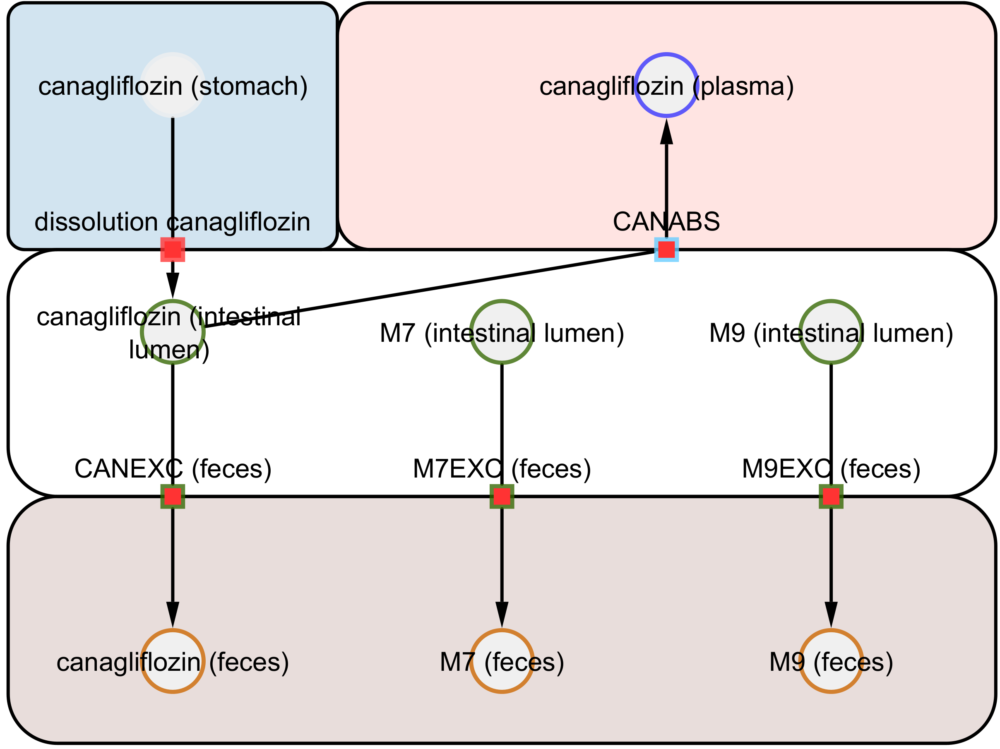
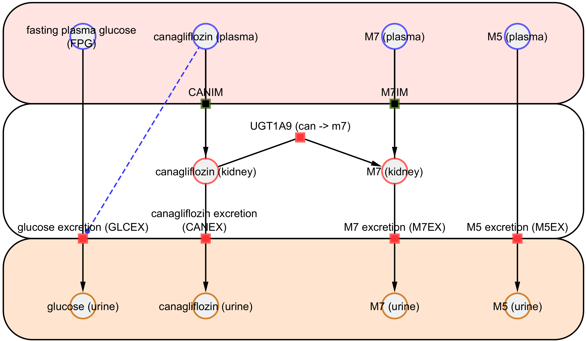
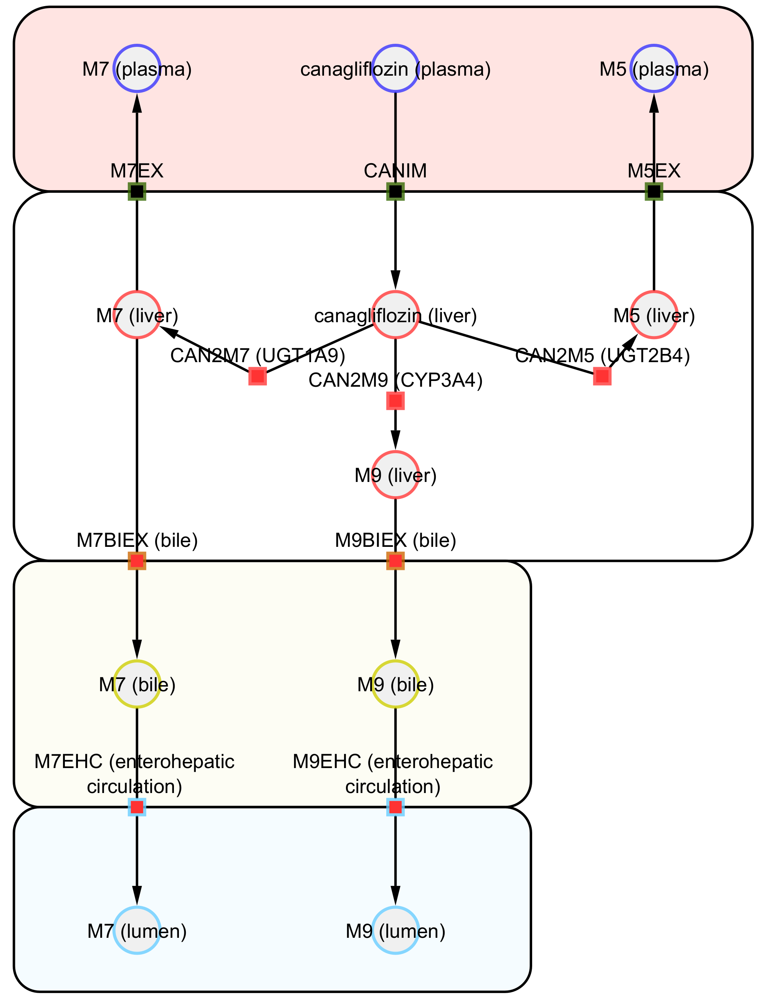

# Models

The models are distributed in [SBML](http://sbml.org) format.

## canagliflozin_body

* Model: [`canagliflozin_body.xml`](https://raw.githubusercontent.com/matthiaskoenig/canagliflozin-model/main/models/canagliflozin_body.xml)
* Equations: [`canagliflozin_body.md`](https://github.com/matthiaskoenig/canagliflozin-model/blob/main/models/canagliflozin_body.md)
* Report: [SBML4humans](https://sbml4humans.de/report?url=https%3A%2F%2Fraw.githubusercontent.com%2Fmatthiaskoenig%2Fcanagliflozin-model%2Fmain%2Fmodels%2Fcanagliflozin_body.xml)

## canagliflozin_body_flat

* Model: [`canagliflozin_body_flat.xml`](https://raw.githubusercontent.com/matthiaskoenig/canagliflozin-model/main/models/canagliflozin_body_flat.xml)
* Equations: [`canagliflozin_body_flat.md`](https://github.com/matthiaskoenig/canagliflozin-model/blob/main/models/canagliflozin_body_flat.md)
* Report: [SBML4humans](https://sbml4humans.de/report?url=https%3A%2F%2Fraw.githubusercontent.com%2Fmatthiaskoenig%2Fcanagliflozin-model%2Fmain%2Fmodels%2Fcanagliflozin_body_flat.xml)

## canagliflozin_intestine

* Model: [`canagliflozin_intestine.xml`](https://raw.githubusercontent.com/matthiaskoenig/canagliflozin-model/main/models/canagliflozin_intestine.xml)
* Equations: [`canagliflozin_intestine.md`](https://github.com/matthiaskoenig/canagliflozin-model/blob/main/models/canagliflozin_intestine.md)
* Report: [SBML4humans](https://sbml4humans.de/report?url=https%3A%2F%2Fraw.githubusercontent.com%2Fmatthiaskoenig%2Fcanagliflozin-model%2Fmain%2Fmodels%2Fcanagliflozin_intestine.xml)

{ style="max-height: 420px; width: auto; max-width: 100%" }

## canagliflozin_kidney

* Model: [`canagliflozin_kidney.xml`](https://raw.githubusercontent.com/matthiaskoenig/canagliflozin-model/main/models/canagliflozin_kidney.xml)
* Equations: [`canagliflozin_kidney.md`](https://github.com/matthiaskoenig/canagliflozin-model/blob/main/models/canagliflozin_kidney.md)
* Report: [SBML4humans](https://sbml4humans.de/report?url=https%3A%2F%2Fraw.githubusercontent.com%2Fmatthiaskoenig%2Fcanagliflozin-model%2Fmain%2Fmodels%2Fcanagliflozin_kidney.xml)

{ style="max-height: 420px; width: auto; max-width: 100%" }

## canagliflozin_liver

* Model: [`canagliflozin_liver.xml`](https://raw.githubusercontent.com/matthiaskoenig/canagliflozin-model/main/models/canagliflozin_liver.xml)
* Equations: [`canagliflozin_liver.md`](https://github.com/matthiaskoenig/canagliflozin-model/blob/main/models/canagliflozin_liver.md)
* Report: [SBML4humans](https://sbml4humans.de/report?url=https%3A%2F%2Fraw.githubusercontent.com%2Fmatthiaskoenig%2Fcanagliflozin-model%2Fmain%2Fmodels%2Fcanagliflozin_liver.xml)

{ style="max-height: 420px; width: auto; max-width: 100%" }

## COMBINE archive

The models and the metadata are available as COMBINE archive from [`canagliflozin_model.omex`](https://raw.githubusercontent.com/matthiaskoenig/canagliflozin-model/main/canagliflozin_model.omex).
